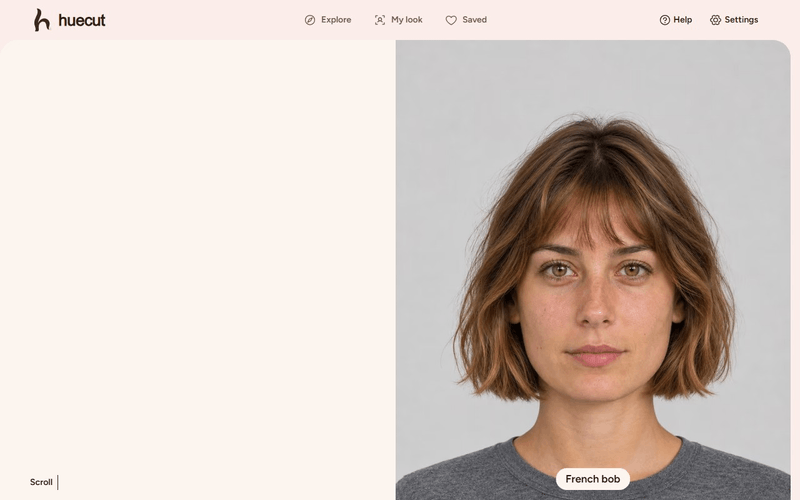
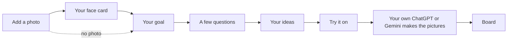

<p align="center">
  
</p>

<h1 align="center">Huecut</h1>

<p align="center">
  <strong>Find a cut and colour that suit your hair, and know why.</strong><br>
  Advice from your photo and your answers, in your web browser. Free and open source. The app never uploads your photos.
</p>

<p align="center">
  <a href="https://sacitdev.github.io/huecut/"></a>
</p>

<p align="center">
  <a href="LICENSE"></a>
  
  
  
  
  
  
  
</p>

<p align="center">
  
</p>
<p align="center"><sub>The demo uses the app's bundled example of a fictional model.</sub></p>

I built Huecut so you can walk into a salon or a barbershop knowing what to ask for, and why.

You add a photo and answer a few questions. Huecut suggests cuts, colours and beards that suit your hair, and tells you why in plain words. Then it writes prompts, so your own ChatGPT or Gemini can show you with each look. It is free and open source. It runs in your web browser, and it never uploads your photos.

Open it here: **https://sacitdev.github.io/huecut/**

Developed by Michael (SacitDev on GitHub).

## What it does for you

- **It listens first.** What you tell it is a firm limit. If you need to tie your hair back, a cut that cannot be tied is not suggested.
- **It looks at your hair.** Your texture, your length, how much hair you have and how much time you want to spend on it all count.
- **It is honest about colour.** Every colour idea says if it is realistic for your hair now, why, and what to ask your colourist.
- **It shows its reasons.** Each idea has a few "Because" lines. Each one is true for that look.
- **It helps you try looks on.** The app writes the prompts. Your own ChatGPT or Gemini makes the pictures. You bring them back and compare them with your photo.



## How to use it

1. **Photo.** Choose **Find my look** and add a photo. The app finds your face points and your hair outline on your own device. Stand about 1.5 metres from the camera, face it, and keep your hair off your face. No photo? Choose **Continue without a photo**, and the ideas come from your answers.
2. **Your face card.** You see what your photo shows about your face, in plain words. Each fact has a number, marked as an estimate. If a line sits in the wrong place, use **Move the lines**. You can save the card as a picture.
3. **Your goal.** Choose Cut, Colour or Both. Then choose Women's styles, Men's styles or All.
4. **A few questions.** One question to a screen. A cut asks up to 10 or 11, a colour up to 12, and both up to 15. Some only appear when an earlier answer calls for them. Most questions offer "Not sure", and an unsure answer does not rule a look out. The one exception is safety: henna of an unknown kind sends colour to a colourist.
5. **Your ideas.** Choose how many, from 1 to 8 (at least 2 when you want both a cut and a colour). Each idea has its reasons and what to ask your stylist. Colour ideas carry an honest label. You can also copy a prompt that lets your own ChatGPT or Gemini pick your best 3 from the app's top 10, looking at your photo.
6. **Try it on.** The app writes the prompts. You take them, with your photos, to your own ChatGPT or Gemini, and it makes the pictures.
7. **Board.** Add those pictures back and compare each one with your photo.

**Explore** lets you browse more than 200 cuts, 68 colour looks and 18 beards, and search them by name. **See an example first** on the home page walks through the steps with a fictional model. It needs no photo and no download. You can also add Huecut to your phone or computer and open it like an app.

The full walk-through is in the [user guide](docs/user-guide.md).

## Privacy

- The app never uploads your photos. A copy leaves the app only when you tap Share or Download, and it goes only to the app you choose.
- There are no accounts and no analytics. Nothing you enter or add is sent anywhere: the site only downloads its own files. The face tool has built-in usage reports, and Huecut blocks them.
- Your session is saved on your own device until you delete it. You can change that to 24 hours, or choose **Delete and don't save**. **Delete my data** on the Saved screen removes everything the app stored, except a **Delete and don't save** choice and the time of the delete, which hold nothing personal.

You can test it yourself. Open the app and let the face tools finish loading. Then switch on airplane mode and carry on. Some things need a connection the first time you use them: the 3D view, the hair outline tool and library pictures you have not looked at yet.

Read more on the [privacy page](docs/privacy.md).

## How the ideas are chosen

I wrote the rules from published salon and barbering practice.

- **What you tell the app is a limit.** A look that breaks it is left out. "Not sure" rules nothing out, except henna of an unknown kind, which sends colour to a colourist.
- **Safety comes first.** In a few cases, such as a past reaction to hair dye or a sore scalp, the app suggests no colour at all. It says why, once.
- **Your hair decides what is possible.** Your texture, density and length, your styling time and your trims set the order.
- **Your face is a small nudge.** It can only move a look up or down among looks that already fit you. It never beats a limit.
- **Fewer is better than a bad idea.** If only three looks fit you, you get three, and the app says what held the others back.

Every number is an estimate, and there are no beauty scores. The suggestions follow what stylists and colourists publish, and they are not science. The [method page](docs/method.md) explains it all, step by step.

## Estimates, not promises

The face card marks each number as a steady estimate, an estimate or a rough estimate. A number can change with the camera angle, the distance and your expression. It can also change with how much of your hairline shows. Colour readings from a photo are hints. Pictures from ChatGPT or Gemini are illustrations. Your stylist or colourist makes the real call.

## How it is built

Huecut is a static website, so it has no server code and no database on a server. What it saves stays in your browser. GitHub Pages hands out the files. Everything is TypeScript. React draws the screens, and one XState machine runs the My look path. A web worker runs the face and hair models (MediaPipe, and Transformers.js for the two extra tools). The advice itself is data: plain JSON files in `content/`.

The [architecture page](docs/architecture.md) is a tour of the code, with diagrams.

## Documents

| Page | What it covers |
|---|---|
| [User guide](docs/user-guide.md) | Every screen, in the order you meet it |
| [How the suggestions work](docs/method.md) | What the app measures and how it chooses, step by step |
| [Privacy](docs/privacy.md) | What happens to your photo, what is stored and how to delete it |
| [Architecture](docs/architecture.md) | The modules, how they connect, and how the site is tested and published |
| [Content guide](docs/content-guide.md) | How to add a haircut, a colour look, a beard or a rule |
| [Demo script](docs/demo-script.md) | How to record a short demo with the bundled example |

## Run it on your own computer

You need Node 24 or newer, and Git. Get the code and open its folder, then install, build and serve it:

```
git clone https://github.com/SacitDev/huecut.git
cd huecut
npm ci --ignore-scripts
npm run models
npm run build
npm run preview
```

`npm run models` downloads the model files once and checks each one against its stored `SHA-256` hash. They are not kept in git. `npm run preview` serves the built site with its security policy at `http://localhost:4180/huecut/`. `npm run dev` runs a development server at `http://localhost:5180/huecut/`, without the policy.

The checks:

```
npm run lint
npm run typecheck
npm test
npm run content:check
npm run e2e
```

`npm run e2e` runs the browser tests against a build. Install the browsers first with `npx playwright install chromium webkit`.

I have not been able to try Huecut on a real iPhone, and the browser tests are not a stand-in for one. If you have an iPhone, a short check on it would help.

## Add a style

Haircuts, beards, colours, questions and the rules between them are JSON files in `content/`. `npm run content:check` tells you exactly what is wrong with a new record. The [content guide](docs/content-guide.md) shows how to add one.

## Give it a web address of its own

Huecut should run on a web address of its own. A custom domain is one way.

Here is why. All GitHub Pages sites by one author share one address, `sacitdev.github.io`. Other pages on that address can read what Huecut keeps in your browser, your saved session and its photo included. They can also replace the offline copy of the app with other code. Huecut keeps its data under the name `huecut`, but that is only a label. It does not stop another page. **Delete and don't save** keeps your session off your device, but it does not change this.

To give your own copy its own address, add a custom domain in the Pages settings. Then set `base` to `'/'` in `vite.config.ts`. Change the address in `index.html` too, and in the footer line of the saved pictures (`src/domain/render-model/copy.ts`). Then build again.

## Licence

Huecut is free software under the [MIT licence](LICENSE). Copyright (c) 2026 Michael (SacitDev). The licence says you must keep that copyright notice if you reuse or change the code. Please keep the credit too. The library pictures show fictional models, and they use the same licence.

The libraries, runtimes and models Huecut runs on have their own licences. They are listed in [THIRD_PARTY_LICENSES.md](THIRD_PARTY_LICENSES.md). The site links this list and the MIT licence too, in Help, under **Credits and licences**.

ChatGPT is a trademark of OpenAI and Gemini a trademark of Google; Huecut is not affiliated with either.
