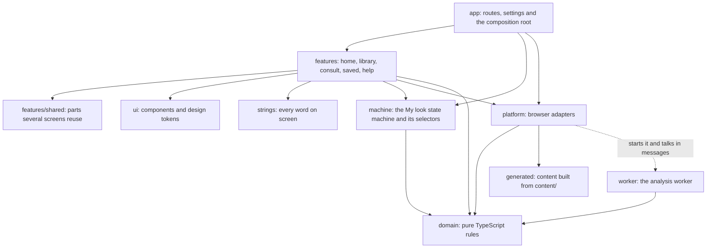
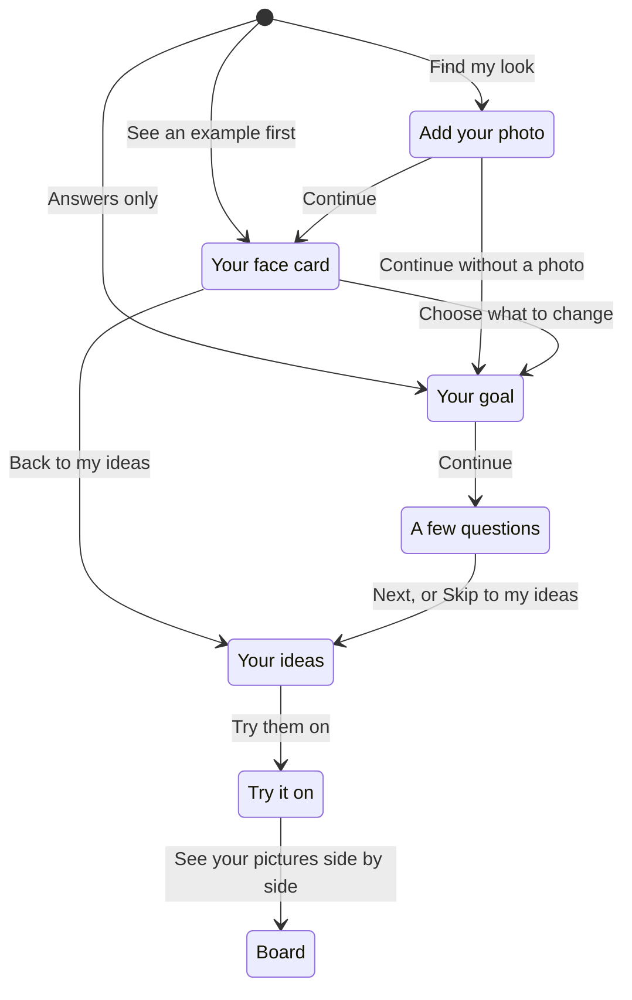
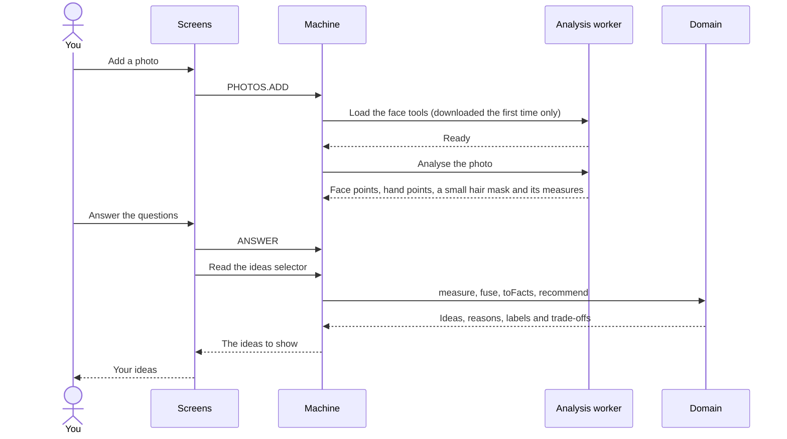
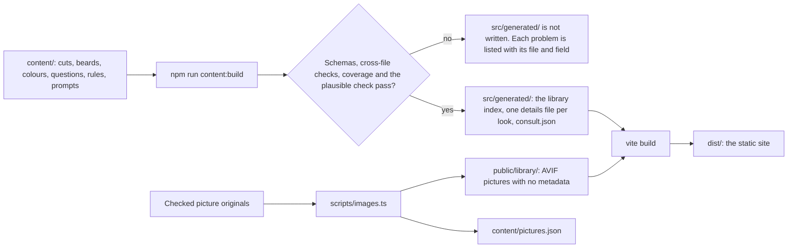
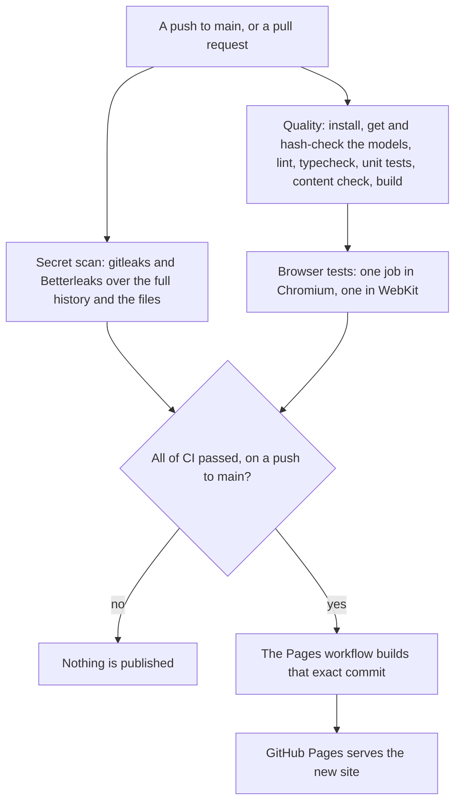

# Architecture

This is a tour of how Huecut is built, for anyone who wants to read or change the code. You do not need to know it to use the app.

## The big picture

Huecut is a static website: HTML, CSS, JavaScript and WebAssembly files, and nothing else. GitHub Pages hands those files out. There is no server of my own, no account, no database on a server and no connection to any AI service. What the app keeps stays in your browser's own storage (IndexedDB). Everything that touches your photo runs in your browser.

I made four design choices first, and the rest follows from them:

- **Privacy first.** Your photo never leaves your device unless you share or download it yourself.
- **Everything on the device.** The face and hair models run in your browser, in a web worker.
- **A static site, no backend.** With no server code, the app never sends your photos or answers anywhere: the host only hands out the files. There is also nothing to keep running.
- **The advice is data.** Cuts, colours, questions and rules are plain JSON in `content/`. A stylist can read and change them without touching the screens.

Everything is TypeScript. React draws the screens. One XState machine owns the My look path, from your photo to your board.

## The modules

`src/` is split into layers. An arrow below shows a main "may import" link. The full list is the matrix in `eslint.config.js`, which the `eslint-plugin-boundaries` plugin enforces, so a wrong import fails the lint.

The `app` layer may import every layer except the worker and `features/shared`. `protocol`, the worker's message types, is imported as types only, never as code. `domain`, `ui`, `strings` and `generated` import nothing outside themselves.

| Folder | What it does |
|---|---|
| `domain/` | Pure TypeScript, with no browser, React or model code: the facts about a person, measuring, the suggestion engine, colour journeys, prompt builders and render models. It compiles without the browser's types, so a stray `document` fails `npm run typecheck`. |
| `machine/` | The one XState machine that runs My look, and the selectors the screens read. It imports no platform code. The real actors are plugged in by `app/compose.ts`. Tests plug in fakes from `tests/machine/`. |
| `platform/` | Adapters to the browser: the analysis client and its supervisor, the resource store, the Canvas painter, storage, clipboard, share and the content loader. |
| `worker/` | Code that runs inside the analysis worker: the fetch allowlist, the model registry, MediaPipe and Transformers.js. |
| `features/` | The screens: `home`, `library` (Explore), `consult` (My look), `saved` and `help`. A feature never imports another feature. `features/shared` holds the few parts several screens reuse. |
| `ui/` | Components that take everything as props, and the design tokens. One hook, `useModalDialog`, gives the bottom sheet, the stylist sheet and Explore's side panel the same dialog behaviour. |
| `app/` | The composition root: routes, the link between the machine and the address bar, the saved session, settings and the injected actors. |
| `strings/` | Every word on screen, in British English. |
| `generated/` | Built from `content/` by `npm run content:build`. It is not kept in git. |

Screens read the machine through selectors and send it events. They never keep their own copy of the workflow state.

## The My look steps

The path is Photo, Your face card, Your goal, A few questions, Your ideas, Try it on and Board. Each step has its own address, `#/my-look/<step>`, so the browser's Back button works as you expect.

A few rules hold everywhere:

- **A step never waits for the photo.** You can answer questions while the face tools load. The face card says what it can, or why it cannot read the photo.
- **A step that is not ready cannot be entered.** Try it on and Board need at least one idea. A link to a step that is not ready is put back to the step you are on.
- **A saved session comes back where you left it.** **Continue where you left off** opens the step you last saw.

## The state machine

`src/machine/consult.machine.ts` holds the machine. While My look is open, three parts of it run side by side:

- **models** looks after the downloads: the core face tools, and the two extras (the depth model and tap-to-select).
- **analysis** reads the photos, one at a time, as soon as the core tools are ready.
- **flow** is the step you are on.

Everything that can be worked out from your inputs is worked out by a selector, never stored: the facts, the ideas, the labels and the prompts. So nothing can go stale, and every safety check runs again on every change. Moving the face lines is an input too, so the card and the ideas follow it at once.

Some selectors read a photo's results, measure them, fuse them, turn your answers into facts and ask the engine. This is the path from a photo to the ideas:

## The analysis worker

The worker is a sensor. It returns points, a small hair mask and a few measures of that mask. The domain code on the main thread decides what they mean.

- **Started from a `blob:` URL.** `platform/analysis/bootstrap.ts` makes a one-line module, `import("<worker file>").catch(() => postMessage({ type: 'boot_failed' }))`, and starts the worker from it as a `blob:` URL. A worker started from its own file would take its security policy from the server's headers, and GitHub Pages cannot send headers. A `blob:` worker takes the page's policy instead. The page's one Trusted Types policy, `worker-bootstrap` in `platform/trusted-url.ts`, lets that URL through. It accepts any `blob:` URL and the site's own service worker, `sw.js`, and refuses every other URL.
- **ES module.** Vite builds the worker as an ES module, which keeps `import.meta.url` a real address.
- **A fence around the network.** `worker/allowlist.ts` replaces `fetch` inside the worker before any model library loads. A file listed in the manifest is served by the registry. Another file on the site's own address passes. Anything else is refused and counted by host. That is how MediaPipe's usage reports are blocked.
- **MediaPipe on the CPU.** The four core tasks (face, hand, pose and the hair segmenter) load once and stay loaded. Closing and re-creating them lost WebGL contexts, so the app never closes them.
- **One call at a time.** `platform/analysis/client.ts` is a small front end over Comlink, with Promises and cancellation. `lane.ts` runs compute calls one at a time. `supervisor.ts` restarts the worker after a crash or a time-out, and it is the only code that ends a worker.
- **The extras load only when asked.** The depth model and tap-to-select use Transformers.js with ONNX Runtime Web. In this version they are offered on computers only (`EXTRAS_ON_COMPUTERS_ONLY` in `app/compose.ts`). The machine decides if an extra may run on a device, from the device class, WebGL, memory, a crash last time and memory running out twice. `ExtraGate.tsx` is the one wrapper that shows the reason, the download, a failure with Try again, or the tool.
- **No support, no problem.** The face tools draw through WebGL on an `OffscreenCanvas` in the worker. If the browser has no `OffscreenCanvas` in workers, or one without WebGL (Safari 16.4 to 16.7, for example), the worker says so before it downloads anything, and you carry on with answers only.

The worker also makes the rough colour preview. It moves the colour of each hair pixel towards the look's target for that part of the hair, inside the hair mask, and leaves every other pixel as it was.

## Model files and the registry

`models.manifest.json` lists every runtime and model file the worker may ask for. Each entry has a path, a `SHA-256` hash, a size, a content type, a source and a licence.

`npm run models` gets each file once, checks its size and hash, and writes it to `public/models/<sha256>.<ext>`. That folder is not kept in git. CI does the same before it builds.

In the browser, `worker/registry.ts` serves each file from the browser's Cache Storage (`huecut-models`, keyed by hash). On a miss it fetches the file from the site, shows the progress, checks the hash, and only then stores it. On a hit it checks the hash again before use. So the bytes that run are the bytes that were checked. The registry covers the model and runtime files, not the app's own JavaScript.

The service worker, `src/sw.ts`, keeps the app's own files and the library pictures you have viewed, so the app opens offline. It never sees a photo. A new version waits until every tab of the old one has closed, so work kept only in memory is never lost to an update.

## Security and privacy in the code

- **A strict page policy.** A small Vite plugin adds the Content Security Policy as a `<meta>` tag, at build time only. `vite dev` injects inline styles that the policy would block. `npm run preview` and the browser tests run under it. `connect-src` is `'self'`, so the page can talk only to its own site. The [privacy page](privacy.md) shows the full policy.
- **Trusted Types are required.** Lint bans `innerHTML` and `dangerouslySetInnerHTML`.
- **One gate for every picture.** `domain/measure/picture-gate.ts` reads a file's first bytes to find its real format and size. A file's name or declared type does not decide. It also caps how many pixels one decode may hold. The main thread and the worker both use it.
- **No late photos.** Each photo import carries the session it began in. It is stored only while that session still holds, so a slow import cannot add a photo after Start again or Delete my data.
- **One stored photo at most.** The only photo ever stored is the one copy in a saved session: at most `1536` px on its longest side, with its metadata removed. `platform/storage.ts` keeps it in IndexedDB. **Delete my data** removes every `huecut` key (except a Don't save choice) and writes one key with the time of the delete, which holds nothing personal, so a save already under way in another tab keeps nothing. Then it removes the `huecut` database, every `huecut` cache and the service worker. Other sites on the same address keep their own storage.
- **No usage data.** The app sends none, and MediaPipe's usage reports are blocked.

## The domain core

- **Facts.** Everything known about a person is a fact, with a key, a value, a confidence and a source: answered, measured or derived. A missing key means unknown, and unknown does not rule a look out on its own. The one exception is safety: henna of an unknown kind is a referral. `FACTS` in `domain/facts/registry.ts` is a closed list: code with a wrong key fails to compile, and a rule with one fails the content check.
- **Coordinates.** Every point is stored as a share of the photo, from 0 to 1, after the photo is turned upright by its EXIF tag. One module turns them into pixels for analysis, for the screen and for saved pictures.
- **Measuring.** `measure()` turns one photo's points into proportions, each with a confidence from the photo checks. Move the lines runs the same code. `fuse()` puts the photos that face the camera together with a weighted median, and counts near-identical photos once. `bands.json` turns numbers into categorical bands. A band close to a boundary drops to low confidence and has no say. Numeric width and jaw ratios retain their measurement confidence.
- **The engine.** `domain/engine/` turns facts into ideas. The [method page](method.md) explains it in plain words. In code terms:
  1. `deriveFacts()` adds what follows from your answers.
  2. `referralFor()` checks the safety cases that stop all colour.
  3. Each cut and colour look is assessed: the `exclude` rules on your answered facts, one score from the `rank` rules, the practical factors and the face's capped factor (`suitability.ts`), and for colour the journey label (`journey.ts`).
  4. Only eligible ideas go on. `select.ts` ranks them and picks a varied list: the full fits first, then trade-offs, then at most two cuts that need growth.
  5. `explain.ts` writes the "Because" lines from the rules that really scored.
  The same facts and content always give the same ideas.
- **Colour per region.** `derive-traits.ts` judges the roots against your natural level and the lengths against their level now, shade by shade, with each technique's own lift on natural or coloured hair. An unknown level in one part never hides what is known in the other.
- **The face card.** `domain/render-model/face-card.ts` builds the card's four facts from the main photo. The screen, the saved card and the "explain my face card" prompt all read the same facts. The engine reads the fused values instead.
- **Prompts.** `domain/prompts/` fills the templates in `content/prompts/`. Every builder checks the same safety input, so after a safety stop no prompt in My look names a hair colour. Explore is an open library for anyone, so its **Copy prompt** still gives each look's own prompt. Each template has a word budget, and `content:check` builds a prompt for every look, and for every cut and colour pair, to prove the budget holds.
- **Render models.** The face card, the stylist sheet, the reference sheet and the board are lists of items. One Canvas painter, `platform/render/painter.ts`, draws them on screen and in saved pictures, so what you see is what you save.

## Content

`content/` holds the data the app runs on, and `scripts/content/` checks and builds it. `npm run build` runs `content:build` first. It draws the colour swatches for the questions, then runs the check, and writes nothing to `src/generated/` while the check finds an error.

Only cuts, beards and colour looks marked `checked` reach the library. Drafts are checked but left out, and the build lists them. The plausible check proves that, for every set of colour questions, some answers to those questions alone still reach Plausible on a library look. So the colour labels can never be so strict that nothing is ever Plausible. It checks the labels only, not exclusions or referrals. The [content guide](content-guide.md) shows how to add a record.

## Languages

The screens are in British English. Settings also offers Latvian. The Latvian text lives in one table, `i18n/lv.md`. `npm run i18n:export` writes that table from the English, and `npm run i18n:import` checks it and builds the two Latvian files the app loads, only when Latvian is chosen. A safety text stays in English until its Latvian has been checked. The prompts always stay in English, and so do the look names they ask the AI to print.

## Tests

- **Unit tests** sit next to the code and run with Vitest. The engine's golden cases are JSON files in `tests/engine-cases/`.
- **Engine sweeps** in `tests/engine/` run on the shipped content, built the same way the app builds it. One sweep checks 10,000 random sets of answers and asserts that every idea the app offers on its own respects what was said. Its checker first proves it can catch a planted mistake.
- **Machine tests** run the real machine with fake actors from `tests/machine/`. The worker's services run in Node with fakes.
- **Browser tests** (Playwright) run against a build, so the security policy applies, in Chromium and WebKit. They check screens at phone and desktop widths, in light and dark, with the axe accessibility checker. A shared guard fails any test on a console error or on a request that leaves the site's own address. The worker test waits for MediaPipe's first usage report and checks that it was blocked, and that no policy was broken in the page or the worker.
- **Test pages.** A few small pages in `tests/harness/` drive the worker, the extras and the painter on their own. They are built only for the tests, never into `dist`.
- **Missing features.** Some tests need a browser feature, such as `OffscreenCanvas` with WebGL in a worker, AVIF pictures, or a Blob in IndexedDB. Such a test asks the browser first. Where the feature is missing, the test is skipped, and the skip names what is missing.

## How the site is tested and published

`.github/workflows/ci.yml` runs on every push to `main` and every pull request. `.github/workflows/pages.yml` runs only after CI has passed on a push to `main`, and it builds the very commit CI tested. Packages install with `npm ci --ignore-scripts`, and every action is pinned to a commit. The browser tests run inside Playwright's own container image, pinned by its digest, which already carries the browsers and their system libraries. The time limits on the jobs are provisional, because no run on Linux has been measured yet.

## Commands

| Command | What it does |
|---|---|
| `npm run dev` | Development server on port 5180, without the security policy |
| `npm run build` | `content:build`, then `vite build` |
| `npm run preview` | Serves the build on port 4180, under the security policy |
| `npm run models` | Gets the model files and checks every hash |
| `npm run content:check` | Checks all content |
| `npm run content:build` | Checks the content, then writes `src/generated/` |
| `npm run lint`, `typecheck`, `test`, `e2e` | The quality checks |
| `npm run licences` | Rebuilds `THIRD_PARTY_LICENSES.md` from the lockfile and the model manifest |
| `npm run i18n:export`, `i18n:import` | Writes and reads the Latvian table |

I have not tried the app on a real iPhone. No browser test result stands in for one.
