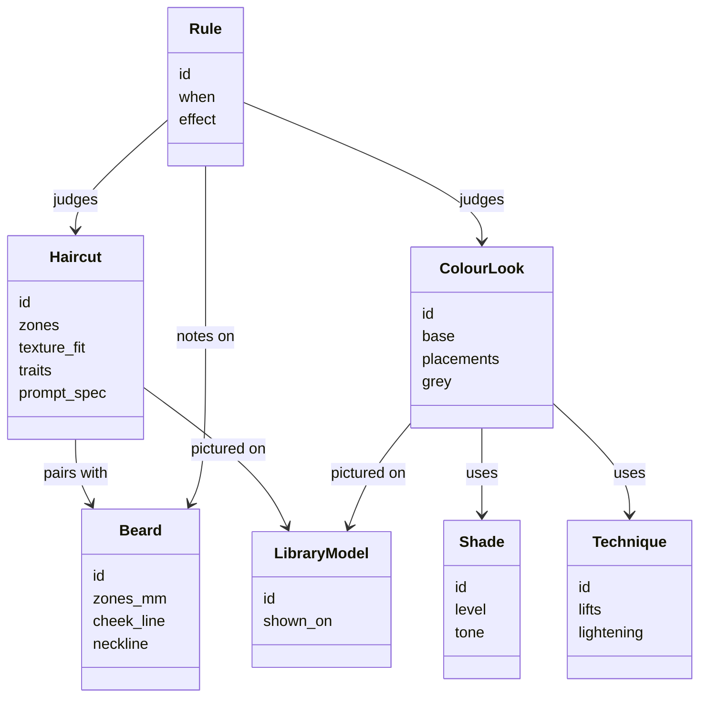
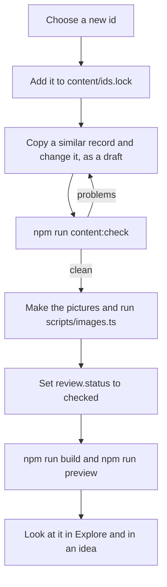

# Content guide: how to add a style

All of the app's advice is data. Haircuts, beards, colours, questions and the rules between them live in `content/`, as plain JSON and Markdown files. You do not need to read the React code to add a style. If you are a stylist, this is the part of Huecut that is yours to improve.

`npm run content:check` is your friend. It checks every file and prints each problem with the file name and the path to the field, so you can fix things one line at a time.

## How the engine uses content

Content feeds every step of a consultation. The [method page](method.md) explains the steps in plain words.

- `exclude` rules leave out the looks that break an answer.
- `rank` rules, the practical factors in `policy.json` and the face's capped factor put the rest in order.
- `note` rules add a note to a look, or to the whole result.
- The colour journey records give each colour look its label, and the reminders and referrals add the safety lines.
- The prompt templates turn a look into words for an AI picture.

## What is where

| File or folder | What it holds |
|---|---|
| `content/haircuts/<family>.json` | Haircuts for both collections, one file for each family (bob, pixie, fade and so on) |
| `content/beards.json` | Beard styles |
| `content/colours/shades.json`, `techniques.json`, `looks.json` | Shades, techniques, and the colour looks that combine them |
| `content/rules/cuts.json`, `colours.json`, `beards.json` | Rules that favour, disfavour or leave out looks, or add a note |
| `content/rules/journey.json`, `reminders.json` | The colour labels (Plausible, Uncertain, Best done by a colourist), the reminders and the safety referrals |
| `content/questions.json` | Every question, and the core sets. A core set holds at most 10 questions for a women's cut, 11 for a men's cut, 12 for colour, and 14 or 15 for both. `content:check` counts them |
| `content/prompts/*.md` | The prompt templates, each with its word budget |
| `content/library-models.json` | The four fictional library models |
| `content/examples/*.json` | The bundled example sessions, one for each library model. `scripts/examples.ts` makes them by running the built app on each model's picture |
| `content/bands.json` | Where the face number bands fall, with a margin near each boundary, and the hair length bands in centimetres |
| `content/policy.json` | The engine's numbers: list size, the practical factors, the face factor, variety and so on |
| `content/phrases.json` | The short phrases the "Because" lines use |
| `content/ids.lock` | Every id ever published |
| `content/pictures.json` | The size and average colour of each library picture, written by `scripts/images.ts` |
| `content/schema/*.schema.json` | JSON Schemas for help in your editor. `node scripts/content/schema.ts` rewrites them |

## Add a haircut

1. **Choose an id.** It is kebab-case, such as `curly-lob-layers`. It must be new: ids are unique across haircuts, beards and colours, and they stay the same for ever.
2. **Add the id to `content/ids.lock`**, on a new line. To retire a style later, add ` retired` after its id on its line. Never delete a line.
3. **Copy a similar record** from `content/haircuts/` into the file for its family, and change it. The main parts are:
   - `name`, `aliases`, `collections` (`salon` for Women's styles, `barbering` for Men's styles) and `family`.
   - `zones`: the length of the top, fringe, sides, back and nape, each as `{ "cm": [min, max] }`. Lengths are measured dry and stretched (`basis`). `perimeter` names the landmark the longest length reaches, such as the chin. These real lengths matter: the engine uses them for top-length answers, for growing out and for covering scars.
   - `fade` (with its start in clipper millimetres), `neckline`, `sideburns` and `fringe`: only where the style has them. Otherwise `null`.
   - `texture_fit` and `density_fit`: for each hair type, `good`, `adapt` or `poor`, with a short note when it is not good. A `poor` fit leaves the cut out for that hair.
   - `upkeep`: styling minutes and trim weeks as `[min, max]`, heat and products.
   - `traits`: the fixed words the rules match on, such as `height_top`, `sides_width`, `fringe`, `layers`, `silhouette`, `tie_back` and `covers_ears`. The allowed values are in `src/domain/content/traits.ts`. Set only what the picture really shows.
   - `client`: two or three plain sentences for a client. `stylist`: a short paragraph in a stylist's words.
   - `prompt_spec`: the look in one sentence for an image prompt, with the real lengths. It must describe the cut itself, and must not mention colour unless the colour is part of the look.
   - `images`: the library model that wears it (`model`) and its `views` (`front`, `side`, `back`).
   - `sources`: where the style is described.
   - `review`: `{ "status": "draft", "date": "…" }`.
4. **Run `npm run content:check`** and fix what it reports. Common problems: the id is missing from `ids.lock`, a trait value does not exist, a word is on the banned list, or a `pairs_with` id points nowhere.
5. **Leave `review.status` as `draft`** until the style has its pictures and someone has looked at it. A draft is checked but left out of the library, so it is safe to propose. `npm run build` lists the drafts it left out.

## Make it visible

A style appears in Explore and in ideas when its status is `checked`. A checked style needs its pictures.

- Pictures show fictional models, in a consistent pose and light. Never a photo of a real person. A style is shown on the library model that matches its collection and hair type.
- Put each original at `<model-id>/<id>-<view>.png`, for example `salon-straight-wavy/curly-lob-layers-front.png`.
- Run `node scripts/images.ts --originals <folder>`. It saves each picture as AVIF at up to three widths, strips all metadata and records the sizes in `content/pictures.json`. It never crops, and never enlarges.
- Run `npm run content:check` again. Every checked style must have its pictures, and no picture may be left without a style.
- Run `npm run build` and `npm run preview`, then look at the style in Explore. Open its detail, and check its caption, its "Because" lines on an idea, and its prompt.

## Add a beard or a colour look

They work the same way, with these differences.

- A **beard** (`content/beards.json`) has `zones_mm` (cheeks, chin, moustache, neck and sideburns), a `cheek_line` and a `neckline`, and lists the cuts it pairs with.
- A **colour look** (`content/colours/looks.json`) is a `base`, a shade and a technique, plus `placements`. Each placement puts a shade, with a technique, on a region such as `root`, `mids`, `ends`, `face_frame` or `highlights`. A shade or technique must already exist in `shades.json` or `techniques.json`.
  - `grey` says what the look does with grey hair: `covers`, `blends`, `tints` or `shows`. The grey goals and the prompts read it.
  - A look whose base is your own colour (technique `none`) names the colour it was pictured on in `base.on`, and marks the words of its `prompt_spec` that describe it in `base.on_words`. A person's prompt then says their own colour there instead.
  - A bright look must name a `required_base_level`, the level the hair is lightened to first, so that the colour safety rules apply.
  - Its `stylist` text must say what the colourist does.
- New **shades and techniques** need their own records and an entry in `ids.lock`. A technique records how far it can lift natural hair and coloured hair (`lifts`). The engine judges each shade with that lift.

## Rules

A rule has an `id`, a `group`, a `target` and a `when`, which holds facts about the person, such as `hair.texture` or `wish.face_length`. It has an `effect`. A `rank` rule has the traits it favours or disfavours, a `reason` in plain words and a `strength`. An `exclude` rule has an `on` match and a `because` sentence. Every rule has an `evidence` level, its `sources` and a `review`.

- **`effect: rank`** moves a look up or down, with a `strength` of `weak`, `moderate` or `strong`. Every rank rule that fires counts once, on one scale, and the total is capped. Texture, density, styling time, trims, growth and the size of a change are already practical factors in `policy.json`. Do not write a rank rule for them as well: it would count twice.
- **`effect: exclude`** leaves a look out, and reads only facts the person answered. A missing answer never leaves a look out. A limit a person states belongs here, not in a rank rule. So does a safety case. The `because` sentence is what the person reads when the limit holds their ideas back, so write it as a full, kind sentence.
- **`effect: note`** adds a note to a look, or with no `on`, to the whole result.
- A match that fits no look in the library fails the check. So does a fact that nothing produces.
- **Concrete wishes**, such as fullness at the sides, more height, or a clean line at the jaw, act through their own rules exactly as stated. They never read the face.
- **The face** does not go in rules. Its say lives in `policy.json` (`suitability.frame`), it is capped at one moderate rule, and it never overrides a limit or a safety rule.
- **Do not weaken the colour safety records** in `rules/journey.json` and `rules/reminders.json` without a very good reason. They only ever make labels more cautious. The check also proves that Plausible is still reachable for each set of colour questions.

## Writing rules for client text

- British English.
- Plain, short sentences. No exclamation marks and no em dashes: the check fails on both.
- Describe what a style does: frames, balances, softens, adds height. Never "fixes", "hides", "slims", "perfect" or "ideal".
- Compare a person with their own face, never with an average.
- Say "model", not "character".
- Do not name celebrities. An alias is the one exception.
- Write your own words. Do not copy text from a web page.

The full list of banned words is `BANNED` in `scripts/content/check-items.ts`, and the check fails on any of them.

## Propose your change

1. Fork the repository and make a branch.
2. Run `npm run lint`, `npm run typecheck`, `npm test`, `npm run content:check` and `npm run build`.
3. Open a pull request. Say what you added and why, with a short note on the source for the style.
