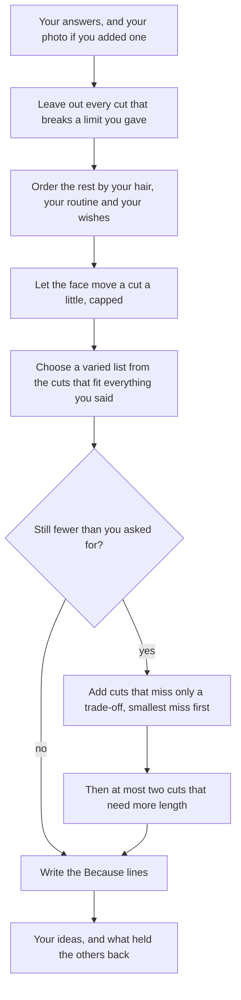
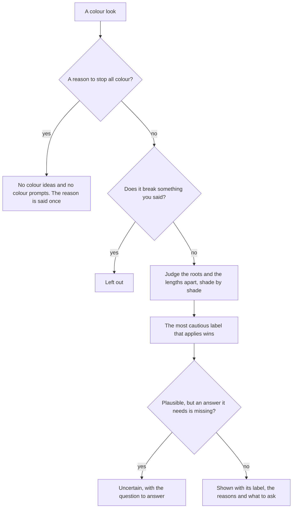

# How the suggestions work

A good salon or barbershop consultation does not start with the scissors. The stylist asks questions, looks at the hair and listens. Then they say what they would do, and why. Huecut works the same way, and this page explains how.

The short version:

- **What you tell the app comes first.** A look that breaks something you said is left out.
- **Safety comes before style.** Some answers stop all colour ideas.
- **Your hair decides what is possible.** Texture, density, length and your routine set the order.
- **Your face only helps the app choose.** It can move a look up or down a little among looks that already fit.
- **Fewer is better than a bad idea.** Three good ideas are better than eight where five are wrong.

The rules follow published salon and barbering practice. I wrote them down from what stylists and colourists publish. They are suggestions, not laws and not science. Huecut never gives a beauty score, and it never says a face needs changing.

## The consultation, step by step

This is the order the app thinks in, for cuts:

Colour follows the same idea, with safety in front. It has its own section below.

Every time you change an answer, add a photo or move a line, the app works it all out again from the start. Nothing is kept from before, so a safety check can never be skipped.

## What the app reads from a photo

All of this happens on your device.

- **Face points.** Hundreds of points on your face, found by Google's MediaPipe tools. From them the app works out how far your head is turned and tilted, and a few proportions.
- **Hand.** It looks for a hand over your face.
- **Hair outline.** A model marks which pixels are hair. The app measures where your hair sits and whether your hairline shows.
- **Colour hints.** It samples the colour of your hair and your skin.
- **Photo notes.** It tells you when a photo has a problem: it is blurred, the face is small, the head is turned, there are two faces or none, a hand covers the face, there is a big smile, or your hairline is hidden. If the camera details are in the file and show the photo was taken close up, it says that too.

Only photos that face the camera give face readings. Side and back photos change no reading. They still go with your photos to your own ChatGPT or Gemini, so the pictures can show more of your head.

Two more tools run only when you ask, and in this version only on a computer. **See it in 3D** uses a depth model, for looking, not for measuring. **Refine my hair outline** lets you tap your hair to correct the outline.

## The face card

The card states up to four facts. A fact the photo gives no reading for is left out. Each one compares a part of your face with the rest of your own face, never with anyone else.

- **Length and width:** how long your face is compared with its width.
- **Forehead:** the top section of your face compared with the other two.
- **Nose to chin:** the lower section compared with the other two.
- **Jaw:** your jaw compared with your cheekbones.

Each fact gets a few plain words, such as "a little longer than it is wide", one neutral line on what hair does there, and a number. There is no verdict and no prescription.

The card shows the readings of your main photo, so the words match the lines you see. If a line sits in the wrong place, **Move the lines** lets you drag six parts: the hairline, the chin, both cheeks and both sides of the jaw. The numbers change as you move them.

The ideas use something a little different: all your photos that face the camera, put together. With several photos the app takes a middle value, and a better photo counts for more. Photos that are almost the same, such as a burst, count once. So with several photos, the card and the ideas can differ a little, and both are true.

### How sure each number is

Every number is an estimate. The card marks each one in one of three ways:

- **Steady estimate.** The photo faces the camera within about 10 degrees each way, it was taken from about 0.9 metres or more, the camera details are still in the file, and it is not blurred.
- **Estimate.** A good reading that is not exact. A photo without camera details can be an estimate at best, because the app cannot tell how far away the camera was. A head turned up to about 15 degrees, a nod, or a little blur also gives an estimate.
- **Rough estimate.** The photo cannot give a steadier reading of that fact.

A few things change this:

- **The jaw is the touchiest reading**, because a camera bends widths most. It is either steady or rough.
- **The forehead needs a level head.** Nodding shortens the forehead in a photo, so a nod of more than about 10 degrees makes it rough.
- **Close-up photos.** A close-up makes the middle of the face look wider. The app says a photo was close up only when the camera details show it was under about 60 cm. Then the width readings are rough and say "approximate (close-up photo)". The face sections are heights, so they can still be an estimate.
- **Cannot read reliably.** If a hand covers the face, the face is very small in the photo, or a big smile moves the lines, the card says so and shows no number. A head turned too far gives no readings at all, and a photo with two faces gives no card.

With several photos, a number the ideas use is as sure as the photo whose value sits in the middle.

### What the app never reads from a photo

- **Your undertone.** Light changes colour in a photo. Your undertone is always your own answer.
- **Your gender or your ethnicity.** You choose Women's styles, Men's styles or All yourself.

## Step 1: what you tell the app is a firm limit

A cut or colour that breaks something you said does not appear. Only your own answers can do this. A guess from the photo never rules a look out, and "Not sure" rules nothing out, with one safety exception: henna of an unknown kind sends colour to a colourist.

These are the limits for cuts:

- **Growing your hair out.** A cut must not take length off. That includes a cut that leaves one part shorter than your hair is now, such as the top of a mullet or the back of an undercut. When your hair reaches your chin or longer, a cut with any part shorter than 2 cm counts as shorter too. Very short crops that you keep short by cutting them back are out as well.
- **Scars or marks to cover.** Any cut with a part shorter than 10 mm, a number 3 guard, is out. If you also have less hair and your scalp shows easily, the line is 1.5 cm.
- **Tying it back.** If you need to tie your hair back, a cut that cannot be tied is out.
- **Fringe.** If you said no fringe, cuts with one are out. If you said you would like one, cuts without one are out. If you are growing a fringe out, cuts that bring back a short fringe are out.
- **Top length.** If you said how long you want the hair on top, cuts whose top is longer or shorter than that are out. The app reads the real length of each cut's top in centimetres.
- **Wash and go.** If you want about 5 minutes a day, cuts that your hair type needs shaped every day, with a pick, a product or a blow-dry, are out.
- **A gentle change.** If you asked for a gentle change, a cut that takes a lot of length off is out.
- **An event soon.** A cut that needs your hair to grow first is out.
- **More than a year of growth.** A cut that needs more than a year of growth is never suggested.
- **Texture and density.** A cut that is a poor match for your texture or for how much hair you have is out. Cuts shaped for curls or a perm are out for straight or wavy hair. Cuts made for a lot of hair are out if you have less.
- **A sore hairline.** If your hairline shows signs of pulling, styles that pull tight are out.
- **Extensions or a weave.** These need your own length, so cuts that take length off are out.
- **Fullness at the sides.** If you asked for it, cuts with close sides are out.

The limits for colour are in the colour section below.

When a limit leaves you with fewer ideas than you asked for, the app says so. It lists the limits that held the others back, in plain words, such as "You need to tie your hair back, so cuts that cannot be tied are left out."

## Step 2: what your hair and your routine can do

Among the cuts that are left, the app asks the questions a stylist asks next. Each answer is a factor, and the factors multiply:

- **Texture and density.** A cut that works as cut on your hair goes up. One that needs adapting goes down a little, and the card says "Needs adapting" with the stylist's note.
- **Styling time.** A cut that takes longer than you said goes down. The further over, the further down.
- **Trims.** A cut that needs trims more often than you said goes down in the same way.
- **Growth.** A cut that needs more length goes down, more for a longer wait.
- **Size of change.** Your answer to "How different do you want to look?" sets how much length a cut should take off. With no answer, a big chop goes down a little.
- **Your wishes and your taste.** The rules you can read in `content/rules/` add or take away points. The looks you tapped as ones you like count too. The points are capped, so a long list of small wins cannot lift a cut that does not suit your hair.

Apart from that one case, an answer you did not give moves nothing.

### Trade-offs, said out loud

Some cuts miss only something you may accept. They need more styling time than you said, trims more often than you said, or a wait for growth when you are not growing your hair. These cuts are not hidden. They wait at the back: they come only after every cut that fits everything you said, and the one that misses least comes first. The card names the trade-off, for example "Needs a trim every 4 to 6 weeks, more than you said."

### Length you do not have yet

Each cut says how it suits your hair today: "Works with your hair today", "Needs adapting", or how much more length it needs, such as "Needs about 5 to 10 cm more length, a few months of growth". The app reads your length as a range of real people, so it uses the middle of that range. Curls sit higher than their stretched length, so with curly or coily hair the app asks where your hair sits when dry, and it allows for that.

At most two cuts that need more length can appear, and only after the cuts you can have today.

## Step 3: what your face adds

This is where the photo comes in. The app treats it the way stylists write about proportions: as a gentle push, never a rule. All the face readings together count for at most as much as one moderate rule. What flatters comes after what you asked for and what your hair can do, so the face only chooses among cuts that are already right for you. With no face reading, this step changes nothing.

How it works:

- **Length and width.** Each cut changes how long or wide a face looks. Width at the sides makes it look wider. Height on top and length past the chin make it look longer. A fringe makes it look shorter. Curls stand out further than straight hair, so they add more. The app compares each cut's effect with a target. It uses the number itself, smoothly, so a small change in the photo makes only a small change in the order.
- **The target.** If you made no wish, the target is halfway between keeping your own proportions and balancing them. That is a default I chose, not a fact about faces. You can choose instead: "A shape that evens out my proportions", "A shape that keeps my own proportions" or "A shape that plays up my own proportions".
- **The jaw** counts only when its reading is steady, or when the jaw is clearly narrow or clearly wide next to the cheekbones.
- **The forehead**, when you made no wish about it: a longer forehead favours a fringe, and a shorter one favours no heavy fringe.
- **Nose to chin**, when you made no wish about the jaw or chin: a longer lower section favours length and volume around the jaw. A clearly wide jaw favours soft ends that fall past it. Neither favours a blunt line at the chin.

A forehead or nose-to-chin reading that sits close to the line between two words has no say at all, so a close call cannot push a cut either way. A reading the photo checks call rough has no say either. A photo that changes nothing is fine: your answers may already decide.

Wishes you choose yourself, such as "Hair that covers more of my forehead" or "More height on top", act through their own rules, exactly as you said them. They do not need a face reading.

## Step 4: a short list with some variety

A list of four near-copies is no help in a consultation. So the app keeps the list varied:

- At most two cuts with the same overall shape, and at least half of the shapes different.
- One low-upkeep option, when one fits.
- At least half of the cuts work on your texture as cut, when there are enough of them.
- After the first idea, each next one is chosen for how well it suits you and for how different it is from the ones already chosen. A cut that suits you much less than the best one is only used to fill a gap.

If the list cannot be filled with all of these, the app lets them go one at a time, in a fixed order. It never lets go of a limit you gave.

With Both, half of your ideas are cuts and the rest colour looks. An odd number gives one more cut. If one side runs short, the app says so. It never fills the gap with looks that break your answers.

The same answers and the same library always give the same ideas.

## Step 5: the reasons

Each idea has up to three "Because" lines. A line only names a reason that is really true for that look. For example: "You would like hair that adds fullness at the sides, so this cut has width at the sides and a curtain fringe." A cut that clearly beats the others on your trims, your styling time or your density says so. A cut that clearly stands out on how it frames your face says what it does, such as "Adds height and keeps the sides close."

**Our pick** marks the first cut and the first colour look. The others say **Also worth trying**. A look you added yourself says so.

## Beards

With Men's styles or All, each cut idea comes with up to three beards that go with it. They are judged with the cut, as one shape: how full your beard grows, what you wished for, and the same face reading. If your growth is patchy, beards that need full cheeks go down. If your nose-to-chin section is longer, beards kept short at the chin go up. A beard that a rule leaves out is never shown.

## Colour

Colour gets its own careful check, because colour can damage hair and skin. This is how one colour look is judged:

### Safety first: when there is no colour at all

Some answers stop every colour idea. Then My look suggests no colour, writes no colour prompt, and says why once, with what to do next:

- hair dye or black henna has made your skin react before
- you have ever had a black henna tattoo
- there is compound henna on your hair, which can hold metal salts
- there is henna on your hair and you do not know which kind
- your scalp is sore, itchy, sunburnt or broken now

The stop covers everything personal in My look: your ideas, the prompts, the stylist sheet and Try it on. Explore is an open library for anyone, so it still shows each look's own prompt.

Your cut ideas stay, in your own colour. A colour look you add yourself shows "Best done by a colourist" and has no prompt. The questions that ask about safety never move on by themselves: you press Next, so a slip of the finger cannot change them.

### How a colour look is judged

The app looks at your roots and your lengths separately, the way a colourist plans a colour service. For each part of your hair:

- **Where it starts.** Your roots start from the colour your hair grows. Your lengths start from the colour they are now.
- **What the technique can do.** Each technique can lift hair only so far. On hair that has been coloured it may lift less: dye cannot lighten dye. A gloss lifts nothing.
- **Each shade on its own.** A look with several shades is judged shade by shade. If a shade is lighter than its technique can take your hair, the look is left out.
- **Your grey.** Each look records what it does with grey: it covers it, blends it, tints it, or leaves it showing. For a look that leaves your grey showing, your own grey can stand in for a light shade your hair could not reach.

### What you asked for is a limit here too

Colourists measure how dark or light hair is in **levels**, from 1 (black) to 10 (the palest natural blonde). The colour questions use the same scale, with a picture for each level.

- **Lighter.** Every look must lift some of your hair. Looks that take your hair two or more levels darker are out, and so are lowlights and looks with no lightener.
- **Darker.** No look may make any of your hair lighter, add lighter pieces or need lightener. Every look must take some of your hair darker.
- **Same depth, warmer or cooler,** or **refresh what I have.** Looks two or more levels lighter or darker are out, and so are roots two or more levels from both your own colour and the one you wear. New lighter pieces are out too, unless you already have highlights and asked for a refresh.
- **Back to my natural colour.** Looks two or more levels from your natural colour, and looks with lighter pieces, are out.
- **Cover or blend my grey.** Looks that leave your grey as it is are out.
- **A bright colour.** Only bright looks. If you chose any other direction, bright colours are out.
- **Your grey goal.** Blend it, and looks that cover it, leave it as it is or take you to silver are out. Let it show or go silver, and looks that cover or tint it are out. Cover it, and looks that leave it showing are out.
- **No grey.** If you have none, grey cover and grey blending are out.
- **Very dark shades** are hard to undo. Looks four or more levels darker than your hair are out when you asked for another direction, or for darker without a big change. Going back to your natural colour, or covering your grey, allows them.
- **Damaged hair, or lengths lightened twice or more.** Looks that lighten the lengths are out. Ask again after a few months of care.

If you asked for lighter or darker and no look can take your hair that way, the app says so plainly. It never turns your direction round.

### The three labels

Every colour look that is left gets one of three labels. Each label comes with its reasons and what to ask your colourist. The most cautious label that applies wins.

- **Plausible.** A small step on hair that can take it. For example: up to two levels lighter on healthy hair that has never been coloured, one to three levels darker on hair in fair condition, or grey cover or blending near your natural colour.
- **Uncertain.** It could go either way, or an answer is missing. For example: three or four levels lighter, brown to light blonde, lightening curly, coily or fine hair by three levels or more, an ash shade over warm hair, red or copper when you want little upkeep, a darker shade on lightened or very light hair, plant henna, a colour correction, or a silver or grey look. With an unknown colour history, or an unknown colour at the lengths, a look is never better than Uncertain.
- **Best done by a colourist.** The bigger or riskier jobs. For example: five or more levels lighter, dark hair to the palest blondes, going lighter over dye or over dark box dye, lightening over henna, lightening relaxed, permed or smoothed hair, lightening damaged hair, a bright shade that needs dark hair lightened first, a much darker shade on very light hair, a perm, relaxer or dye in the last two weeks, or pregnancy, breastfeeding or medical treatment. (A sore scalp is not on this list: it stops every colour suggestion, as described above.)

If no rule speaks for a look, it is Uncertain.

**Plausible is never shown on a guess.** It promises a known, small lift on hair that can reach the shade. If an answer it needs is missing, the label is Uncertain and names the question to answer, as in "Answer ‘How is your hair feeling at the moment?’ to narrow it down".

A few more things the app holds to:

- A recent dye means a colourist should look at your hair first. The app never says a colour is "safe after so many days".
- With mostly grey hair, a silver gloss mostly tones the grey you already have. The label counts the lift from your darkest strands, so it can be more cautious than you need.
- Every colour look reminds you of the allergy skin test that the colour maker and your colourist ask for. Looks with lightener also suggest a strand test.
- Nobody can promise how many visits a colour change takes. Your colourist judges it as they go.

### The order of colour looks

What you asked for comes first. Then the label: a Plausible look goes before an Uncertain one, and both go before Best done by a colourist. One clear preference of yours can outweigh the step from Plausible to Uncertain. It takes two strong ones to outweigh Best done by a colourist. At the same preference and label, the smaller change comes first. If you gave your undertone, swatches that sit well with it break a tie.

The list is kept varied by colour family, technique, warmth and depth, and it holds one low-upkeep look when one fits.

### Colour in your results

With Cut or Both, **Colour in your results** sets how colour appears in every cut idea, prompt and card: **Keep my colour**, **One colour for all**, or **Pick colours for me**. A colour that a rule leaves out is never used. If none fits, your ideas stay in your own colour, and the screen says so.

### Worth asking a colourist about

With Men's styles only, the colour list can run short. Then the app may show a few salon colours that are one colour all over, so hair length does not matter. They sit apart, under **Worth asking a colourist about**, because they are not full matches. They are never shown after a safety stop.

## The prompts

The picture prompts describe the look, with its real lengths, and ask the AI to keep you as you are: your face, skin tone, eye colour, hairline, density, curl pattern, glasses, beard and background. A beard look leaves the beard off that list. The picture prompts never carry your face numbers or your answers, with one exception below.

- A cut prompt asks the AI to keep your hair colour exactly as it is.
- A colour look that is built on your own colour describes your own colour in the prompt, never the colour of the model in the library picture. When your answers give one clear level for the hair the look leaves alone, the prompt names that level. This is the one answer a picture prompt carries.
- A look that keeps, blends or tints your grey never says how much grey you have.

**Let ChatGPT or Gemini pick your best 3** is different. It is a text prompt for your own ChatGPT or Gemini, with your photo. It lists the app's top ten looks, your hair answers, what you need, the face notes and any trade-offs, as far as its word limit allows. It asks your AI to pick three, say why, and show you in the first. It asks it not to judge or grade your face. The app is not connected to either service and does not read the answer.

The prompts are always in English, whatever language the screens show.

## What the app does not promise

- **A result.** Neither the colour preview nor the pictures from ChatGPT or Gemini show what your hair will look like. They are illustrations. The colour preview is labelled "Rough preview".
- **A likeness.** AI pictures often change a face a little, and often give you more hair than you have.
- **A salon outcome.** Only your stylist or colourist can say what your hair can really do.

## Phones and other browsers

- The 3D view and Refine my hair outline run on computers only in this version. In a test that slowed a computer down to act like a phone, they used too much memory or ran too slowly. That test is preliminary.
- I have not been able to try Huecut on a real phone. A short check on a real iPhone would help. Tests in other browsers are not a stand-in for one.
- If your browser lacks a feature the face tools need, the app says so, and you can carry on with answers only.

## If you find a mistake

Open an issue on the [Huecut issues page](https://github.com/SacitDev/huecut/issues). Please do not paste photos or personal details.
