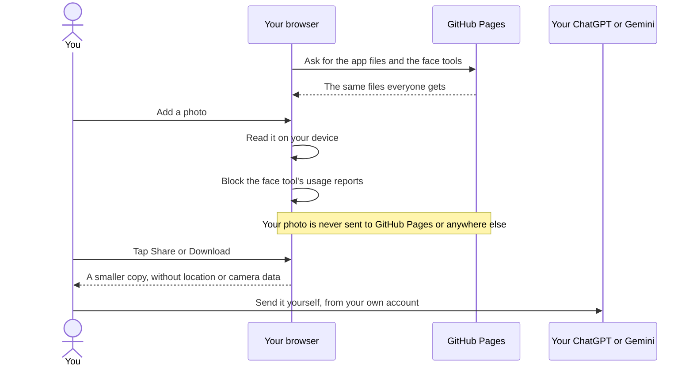

# Privacy

The short version: **the app never uploads your photos.** A copy leaves the app only when you tap Share or Download, and it goes only to the app you choose.

Your photos are personal. I wanted Huecut to be simple about that, and I wanted this page to say plainly what is true and what is not.

## Where your photo goes

- Your photo is opened and read inside your browser, on your device.
- There is no server that receives it. The site is a set of files that GitHub Pages hands out, the same for everyone.
- There are no accounts, no analytics and no tracking.
- The app is not connected to ChatGPT, Gemini or any other AI service.

## When a copy of your photo leaves the app

Only when you ask. To see yourself with a new look, you take your photo to your own ChatGPT or Gemini. The app helps in two ways:

- **On a phone or tablet**, **2 Share photo** opens your device's share sheet, and you choose the app.
- **On a computer**, **Download photo for AI** saves a copy to your downloads, and you attach it yourself.

On **All together**, the same buttons share or download your photos with the reference sheet, up to nine photos, your main photo first.

The copy for an AI chat is smaller than your original. Its long side is at most `1536` pixels, and it is saved again without the location and camera details. The files are named `huecut-photo.jpg`, `huecut-photo-2.jpg` and so on, so a file name says nothing about you. What ChatGPT or Gemini do with what you give them is set by their own terms and your own account. Please read those before you use them.

**Save my face card**, **Save board** and **Save as image** on a stylist sheet make a picture on your device and either share it or download it. Nothing is sent anywhere else.

The copy buttons put a prompt on your clipboard. **Copy and open ChatGPT** and **Copy and open Gemini** also open that service in a new tab. They never put your prompt in the web address, because a web address can end up in browser history and server logs. You paste the prompt yourself. A prompt can hold what you told the app about your hair. The prompts that explain your face card or pick your best looks also hold the face notes.

## What the app blocks

The tool that finds your face points is Google's MediaPipe. It has built-in usage reports, and it tries to send them about once a minute. Huecut blocks them in two ways:

- The page's security policy covers the page and the face tools. It lets them load from and send to only the site's own address, so it stops every request to another site.
- Inside the face tools, the app also wraps `fetch`, the call the tools use to get files and send their reports. A `fetch` to the site's own address gets through. Any other `fetch` is refused and counted.

Nothing is sent. **Help**, under **Privacy**, shows how many were blocked in your session.

## Test it yourself

1. Open the app and let the face tools finish loading.
2. Switch on airplane mode.
3. Carry on.

After the face tools have loaded once, the app works without a connection. Tools you have never opened need a connection the first time: the 3D view and Refine my hair outline. So do library pictures you have not looked at yet. If you switch to airplane mode before your first visit has finished loading, parts of the app may be missing.

For a closer look, open your browser's developer tools and watch the Network tab. Every request goes to the site's own address.

## What is stored on your device, and for how long

| What | Where | How long |
|---|---|---|
| Your photos, previews and full-size hair outlines while you work | In the open page (memory) | Until you remove them, start again or close the tab |
| Your saved session: your answers, your ideas, your AI pictures, one smaller photo of your face with its metadata removed, and that photo's analysis: the points found on your face, hands and body, expression scores, hair measures and colour hints, a small hair outline, the lens focal length if the photo named it, and any lines you moved | Your browser (IndexedDB) | By default until you delete it or your browser clears it. With **Keep for 24 hours**, it is deleted the next time the app runs after 24 hours. With **Delete and don't save**, nothing is saved and any saved copy is deleted |
| Your saving choice, favourites, theme, motion, language, last Explore filters, and the time of your last delete | Your browser (local storage) | Until you delete them. Nothing personal |
| A short marker naming the 3D or hair tool while it runs, so a crash can be noticed next time | Your browser (session storage) | Until the tool finishes or you close the tab |
| The app's files, library pictures you viewed, and the face tools | Your browser (cache) | Until you delete them or your browser clears them |

Explore's search box is not stored by the app. It is part of the page address, though, so it stays in your browser's history.

## The three saving modes

Saving starts with your first answer or photo. Opening Huecut saves nothing about you. You choose how long your session is kept:

- **Keep until I delete it.** This is the default.
- **Keep for 24 hours.** The session is deleted the next time the app runs after 24 hours.
- **Delete and don't save.** Any saved copy is deleted now. Nothing is saved until you choose a period again.

A saved session is not a backup. Anyone who uses this browser can see it, so please do not use it on a shared computer. The bundled example saves nothing.

When a session is first saved, the app asks your browser to keep the data. The browser may say no. If it does, the only change is that the browser may clear the data sooner. Safari may clear stored data after 7 days without a visit.

## Delete my data

**Delete my data** on the Saved screen removes everything in the table above, except a **Delete and don't save** choice. Before it removes your saved session, it notes the time of the delete, which holds nothing personal, so that a save already under way in another tab keeps nothing. That is your saved session with its photo and pictures, your favourites and your settings, the library pictures you viewed, the face tools you downloaded and the offline copy of the app. It clears the photos open in My look too. It asks you first.

If you chose **Delete and don't save**, that one choice stays, so nothing is saved by surprise afterwards. It is not personal.

Deleting can be blocked, for example when another tab of Huecut is open. Then the app does not claim it is done. It says some of your data could not be deleted, and asks you to close your other tabs and try again.

## A shared web address

All GitHub Pages sites by one author share the address `sacitdev.github.io`. This matters, and it is a risk I have not removed. Other pages on the same address can read the saved session in your browser, your photo included. They can also change the offline copy of the app, and so change what the app runs. Huecut keeps its data under names that start with `huecut`, but that is only a label. It does not stop another page.

**Delete and don't save** keeps your session out of storage, but the offline copy of the app is still there.

Huecut should run on a web address of its own. A custom domain is one way. The [README](../README.md) says how to set one up.

## Where the tools come from

The face, hair and depth models, and the runtime files that run them, are files on the site itself. Each one is listed in `models.manifest.json` with its `SHA-256` hash. The app checks every file against that hash before it uses it, the first time and every time after. This covers the models and their runtime files, not the app's own page code. Nothing is fetched from another site at run time. After the first visit, the tools stay in your browser's cache.

## For developers

- The page policy is a `<meta>` tag that the build adds:
  `default-src 'self'; script-src 'self' 'wasm-unsafe-eval'; worker-src 'self' blob:; connect-src 'self'; img-src 'self' blob: data:; media-src 'self' blob:; style-src 'self'; font-src 'self'; object-src 'none'; base-uri 'none'; form-action 'none'; require-trusted-types-for 'script'; trusted-types worker-bootstrap`.
- The analysis worker starts from a `blob:` bootstrap, so the page's policy applies to it. GitHub Pages cannot send headers.
- Inside the worker, an allowlist stands in for `fetch`. It answers the files in `models.manifest.json` from a registry that checks their hashes, lets other files on the same site through, and refuses and counts everything else by host.
- The browser tests fail on any request that leaves the site's address. They also check that MediaPipe's usage report was blocked after its first call, and that no policy was broken in the page or the worker.
- `innerHTML` and `dangerouslySetInnerHTML` are banned by lint.
- **Tell us how it went** on the Board opens a GitHub issue form in a new tab. Nothing from your session goes with it.

If you find a privacy problem, please open an issue on the [Huecut issues page](https://github.com/SacitDev/huecut/issues). Leave out photos and personal details.
