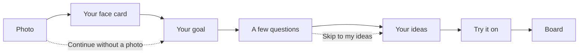
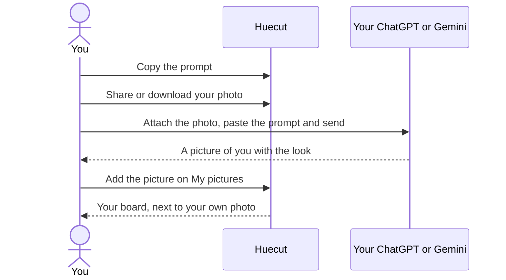

# User guide

I built Huecut to help you choose a haircut, a hair colour and a beard, and to know why. This guide follows the app in the order you meet it.

There is nothing to install. Open [Huecut](https://sacitdev.github.io/huecut/) in a recent browser, on a laptop, a tablet or a phone.

## The big idea

1. The app looks at your photo and listens to your answers.
2. It suggests looks that suit your hair, and says why.
3. It writes prompts. You take them, with your photos, to your own ChatGPT or Gemini, and it makes pictures of you with each look.
4. You bring those pictures back. The app puts them on a board you can save and show.

The app is not connected to ChatGPT, Gemini or any other AI service. The pictures of you are made in your own account, outside the app.

The app never uploads your photos. A copy leaves the app only when you tap Share or Download, and it goes only to the app you choose.

## Use it like an app

You can add Huecut to your phone or computer and open it like an app. If your browser offers it, tap **Install Huecut** on the home page or in Help. On an iPhone or iPad, tap Share, then Add to Home Screen. An installed app still keeps your data only on that device, so it is not a backup.

After your first visit has loaded, the app opens without a connection, and the face tools work offline once they have loaded. Some things need a connection the first time: the 3D view, Refine my hair outline and any library picture you have not looked at yet.

## Finding your way

The menu is **Explore**, **My look** and **Saved**. **Help** and **Settings** sit in the top bar on every screen.

- **Explore** is the library. You can browse it without a photo.
- **My look** is the path from your photo to your board.
- **Saved** holds your favourites and your saved session.
- **Help** explains how the app works, privacy, how things are measured, how to use prompts, and the credits.
- **Settings** has the theme (System, Light or Dark), motion (Follow my device, or Reduce) and the language (English or Latviešu).

## Explore

Explore has three tabs: **Styles**, **Colours** and **Beards**. Use **Show** to choose Women's styles, Men's styles or All. This is your choice. The app never guesses it.

- **Search by name** finds a look by its name or another name it goes by. The app does not store what you type, but it is part of the page address, so it stays in your browser's history.
- Filter styles by length, texture, fringe, upkeep and two common worries: "Works with a hairline higher at the temples" and "Works with fine hair". Filter colours by family, technique and upkeep, and beards by length and shape.
- Tap a picture to open it. A style shows a front, side and back view, a plain description, its lengths and upkeep, and "Works with your hair if…".
- The models in the pictures are fictional. A caption says what the model's hair is like, for example "Shown on 3C to 4A curls and coils".
- **Copy prompt** writes a prompt for that look, to paste into your own AI chat with your photo.
- **Show your stylist** opens a sheet with the details a stylist needs. Copy it as text, or save it as an image.
- **Save** (the heart) keeps it in your favourites.
- **Find my look with this style** adds a cut or a colour look to your ideas.

## My look

The steps are Photo, Your face card, Your goal, A few questions, Your ideas, Try it on and Board. Each step has its own page, so your browser's Back button takes you to the step before.

### Saving

Your session is saved on your device by default. **Saving this session** says what is kept and offers three choices:

- **Keep until I delete it** (the default).
- **Keep for 24 hours.** It is deleted the next time the app runs after 24 hours.
- **Delete and don't save.** This removes any saved copy now, for good, and nothing is saved until you choose a period again.

Saving starts with your first answer or photo, not when you open the app. It keeps your answers, your ideas, one smaller photo of your face and any AI pictures you add. They stay in this browser on this device until you delete them or the browser clears them. So it is not a backup. Anyone who uses this browser can see it, so please do not use it on a shared computer.

Next time, the home page offers **Continue where you left off**, and **Start again**, which asks first. Saved shows the same saving control.

### Photo

Add photos with **Choose photos**, drop them in, or paste one. On a phone, **Take a photo** opens the camera. JPEG, PNG, WebP and HEIC work, if your browser can open them. The app looks at what is inside the file, not only at its name.

- One clear photo from the front is enough. Stand about 1.5 metres away in soft daylight, or ask someone to take it, and keep your hair off your face. You can add side and back photos too. They do not change the face readings, but they go with your photos to your own ChatGPT or Gemini, so the pictures can show more of your head.
- Each photo gets a short note if something is off, such as "This photo is a little blurred". Notes never stop you.
- On a phone, the app reads your 15 clearest photos and tells you so. Make another photo your main photo to read that one.
- The first time, the face tools download, about 38 MB. Wi-Fi is best. You can cancel.
- You can answer questions while the tools load.

No photo? Choose **Continue without a photo**. Your ideas then come from your answers.

### Your face card

The card shows your main photo with thin lines along your face outline, hairline, brows, eyes, nose, lips, jaw and chin. Below it are up to four facts about your face, each in plain words:

- **Length and width**
- **Forehead**
- **Nose to chin**
- **Jaw**

Each fact says what your photo shows, gives one neutral line about what hair does there, and has a number. Every number is an estimate, marked in one of three ways:

- **Steady estimate:** you faced the camera from a good distance, and the photo still has its camera details.
- **Estimate:** a good reading that is not exact, for example from a photo without camera details.
- **Rough estimate:** the photo cannot give a steadier reading of this fact. The jaw is the touchiest, because a camera bends widths most.

A number can change with the camera angle, the distance and your expression. It can also change with how much of your hairline shows. A fact the photo gives no reading for is left out. If part of the face is covered, the face is too small in the photo or a big smile moves it, the facts say "cannot read reliably". A photo taken close up says so, and its readings are approximate. If the photo cannot be read at all, the app says why and offers **Choose another photo**.

The card shows your main photo. Your ideas use all your photos that face the camera.

On this screen:

- **Save my face card** saves the card as a picture, with the facts and numbers on it.
- **Move the lines**: if a line sits in the wrong place, drag a dot to the right place, or pick a part and use the arrows. You can move the hairline, the chin, the left and right cheek, and the left and right jaw. **Put back** undoes one part. The facts update as you go.
- **More with your photo** lists extra tools:
  - **Try a colour on your photo** tints your hair on screen. It is labelled "Rough preview". For a look with highlights or face-framing pieces, it shows the main shade, and says your colourist places the highlights.
  - **See it in 3D** is for looking, not for measuring. You can turn it a little left and right, and tilt it a little.
  - **Refine my hair outline** appears only when the outline may be unsure. You tap your hair to fix it.
  - **Copy a prompt to explain my face card** is for pasting into ChatGPT or Gemini. The app does not read the answer.
  - **Colour hints** show a hair colour and a skin tone read from the photo, both hints only, and your own undertone answer.

The 3D view and Refine my hair outline run on computers only in this version. Each shows its download size first.

### Your goal

Choose **Cut**, **Colour** or **Both**, and choose Women's styles, Men's styles or All. Nothing is chosen for you. Then continue.

### A few questions

You answer one question on each screen, about your hair, your routine and what you would like. A cut asks up to 10 or 11, a colour up to 12, and both up to 15. Some only appear when an earlier answer calls for them, so the count at the top ("Question 3 of 9") can go down as you answer. Some questions use drawings, colour swatches or pictures. "Tap the looks you like" lets you tap up to three pictures of looks you like.

"Not sure" is the last answer on most questions, and it does not rule a look out. The one exception is safety: if you have henna on your hair but do not know which kind, colour goes to a colourist. The question about what your hair should do for your face has no "Not sure": choose any, or none.

What you answer is a firm limit. Say you are growing your hair out, need to tie it back, want scars covered, or asked for no fringe. Looks that do not fit then do not appear.

- Tap an answer and the app moves on. With a keyboard or a screen reader, choose an answer and press **Next question**. The safety questions always wait for Next.
- One colour question asks if hair dye or a black henna tattoo has ever made your skin react, and if your scalp is sore now. A second one on the same screen asks if you have ever had a black henna tattoo. If you have had a reaction, have such a tattoo, or your scalp is sore, the app suggests no colour at all. It says why, once. The same happens with compound henna, or henna of a kind you do not know.
- **Skip to my ideas** is always there.

### Your ideas

Choose how many ideas you want, from 1 to 8 (4 to start; at least 2 with Both). With Both, half are cuts and the rest colour looks, and an odd number gives one more cut. The list holds 8 ideas at most, including any you add yourself.

Your answers set the limits, and your face is one gentle input beside them. [How the suggestions work](method.md) explains it.

Each idea shows a picture on a fictional model, its name, up to three "Because" lines, and how it suits your hair today. You may see "Works with your hair today", "Needs adapting", or "Needs about 5 to 10 cm more length, a few months of growth". If a cut needs more styling time or more trims than you said, it says so, for example "Needs a trim every 4 to 6 weeks, more than you said". Such cuts only come after the ones that fit everything you said.

- **Our pick** marks the first cut and the first colour look. The others say **Also worth trying**. A look you added says **You added this**.
- **Colour ideas** carry a label: Plausible, Uncertain or Best done by a colourist, with the reasons and what to ask. The app never says Plausible on a guess. If a missing answer could change the label, it says "Answer … to narrow it down", and you can answer right there.
- **Before any colour** lists the reminders that go with every colour, such as the allergy skin test.
- **Colour in your results** (with Cut or Both) sets how colour appears in every idea, prompt and card. **Keep my colour** shows every cut in your own colour. **One colour for all** uses one colour you choose. **Pick colours for me** lets the app pair colours with your cuts.
- **Pair a cut with a colour** lets you pick one cut and one colour look to try as one picture.
- **See it on me** shows a rough colour preview on your photo.
- **Show your stylist** opens the sheet for that idea.
- **Move earlier** and **Move later** change the order. **Remove** takes an idea off your list, and the next one takes its place.
- **Worth asking a colourist about** can appear with Men's styles when few colour looks fit. These are salon colours in one shade all over, so hair length does not matter. They are not full matches, so a colourist should say if they would work for you. You can add one to your list.
- **Let ChatGPT or Gemini pick your best 3** copies a prompt with your answers, the face notes and the app's top ten looks. Paste it into ChatGPT or Gemini with your photo. It picks three, says why, and shows you in the first. The app does not read the answer.
- **Improve my ideas** has more questions, all optional. Your ideas update as you answer.
- **Add from Explore** adds a look you found there. A look that breaks one of your answers stays on your list, with the reason shown, unless you remove it.
- If fewer ideas fit than you asked for, the app says so, and says what held the others back.

## Try it on

Try it on has four tabs: **All together**, **One by one**, **My pictures** and **Tips**.

This is how a prompt becomes a picture:

### All together

This makes the finished card: one picture from your own ChatGPT or Gemini, with several looks and their names.

- Choose how many looks go in one picture, up to 6, or split them, for example 3 and 3.
- Each card has a prompt and a reference sheet. The app makes the sheet from the library pictures of your looks, numbered to match the prompt.
- On a phone or tablet, tap **1 Copy prompt**, then **2 Share photos and reference sheet**, and choose ChatGPT or Gemini. On a computer, copy the prompt, open a chat, attach your photos and the reference sheet, paste the prompt and send. Up to nine photos go with the card, your main photo first.
- **Copy and open ChatGPT** and **Copy and open Gemini** copy the prompt and open that service in a new tab. You attach your photos and paste the prompt yourself.
- Save the card it makes.

AI can change a name or a face, so compare the card with the list on screen.

### One by one

Each look has its own sample picture, prompt and buttons. One prompt for one look often gives a closer picture of you.

- A pair you made comes first.
- **Face looks different?** copies a short repair prompt for the same chat.
- A colour look shows its label, such as "Colour: Best done by a colourist", above its prompt. After a safety answer that sends colour to a colourist, a look that names a colour shows "Best done by a colourist" instead of a prompt.

### My pictures

Add the pictures your chat made. Each look has an **Add picture** slot. Choose a file, paste one (Ctrl+V) or drop one in.

**Several pictures at once** is another way. One prompt asks for up to 4 looks in one picture, with no text. Add that picture, and the app cuts it into one tile per look. You confirm which look each tile shows before the names are attached. If the tiles look wrong, use One by one instead.

### Tips

- Start a new chat for each look.
- Always attach your own photo, never an AI picture.
- The prompt asks the AI to keep your face, skin tone, eye colour and glasses, and your hairline, density, curl pattern, beard and background. It cannot promise that.
- AI often gives more hair or a fuller hairline than you have. Your stylist knows what your hair can do.

On a phone or tablet, switching to ChatGPT or Gemini can reload the page. If your session is saved, you pick up where you left off.

## Board

The board shows one tile for each look, with the picture you added and the app's name for the look. Each tile says it is an AI picture, an illustration of the look.

- Tap a tile to slide between your photo and the AI picture.
- A colour tile, and the pair, has a **Hair-only version** switch. It keeps your real skin and background, and takes only the hair colour from the AI picture.
- **Save board** saves a picture of the board. Its footer names Huecut and its address.
- **Tell us how it went** opens a new issue on GitHub in a new tab. Nothing from your session goes with it.

## Saved

- **Saving this session**: the saving control described above, with the time left if you chose 24 hours.
- **Your favourites**: styles, colour looks and beards.
- **Delete my data** removes everything the app stored on this device: your favourites, your settings, your saved session with its photo and pictures, the library pictures you viewed, the face tools you downloaded and the offline copy of the app. It asks first. If you chose **Delete and don't save**, that choice stays. The app also notes the time of every delete, which holds nothing personal. If another tab of Huecut is open, the delete can be blocked. The app then says some of your data could not be deleted, and asks you to try again with your other tabs closed.

**See an example first**, on the home page, walks through My look with a fictional model. No photo, no download, and nothing is saved. **Try another model** switches to another one, and **Start with my photo** begins your own.

## Problems and answers

- **"The face tools could not load."** Tap **Try again**, or choose **Continue with answers only**.
- **"The face tools cannot run in this browser."** Try another recent browser, or carry on with your answers.
- **"The download stopped."** Nothing moved for 30 seconds. Tap **Download again**.
- **A photo has a note.** The note says what it is, such as two faces or no face found.
- **Your photo is a HEIC file and does not open.** Add a JPEG copy instead. On an iPhone, the camera setting "Most Compatible" makes one.
- **Copy did not work.** The prompt is shown in a box and selected. Copy it from there by hand.
- **You are offline.** Explore and anything you have already used still work. Tools you have never opened, and library pictures you have not looked at yet, need a connection.

If you open the site inside another app, such as a social app, you may see a notice. Photos, saving and sharing work better in Safari or Chrome.
